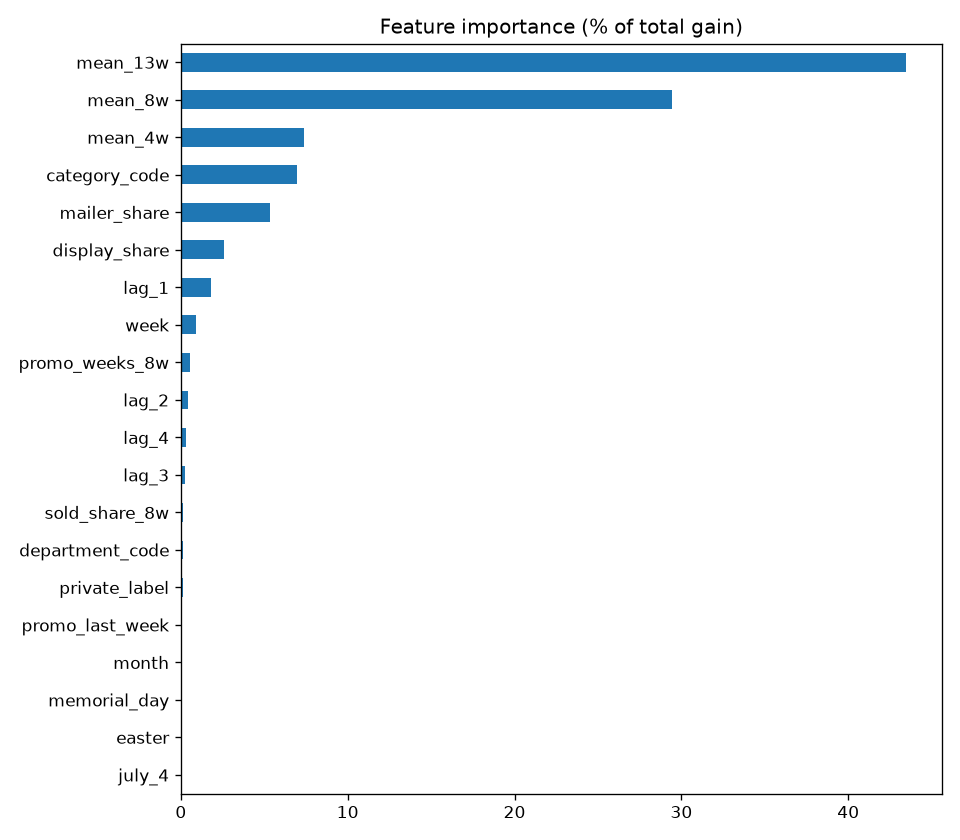
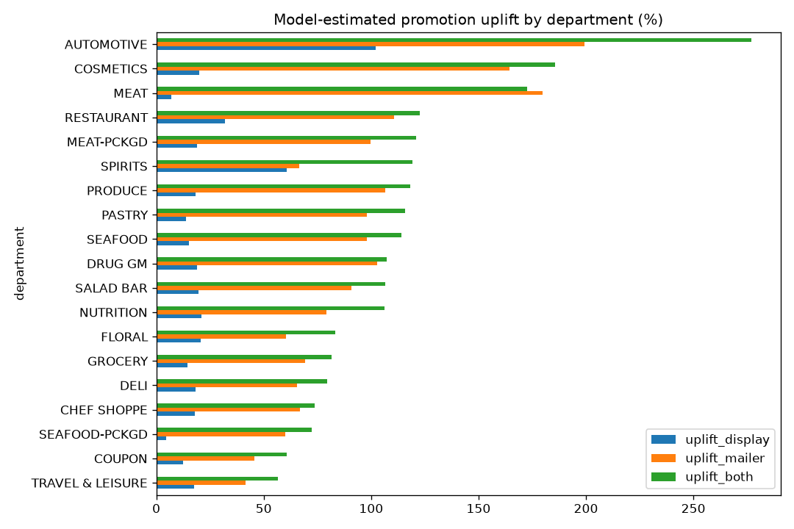

# Promotion Optimization System

AI-powered retail promotion planning platform by **Tauseef Iqbal**. It started as a 2025 prototype at **NUST University** and was rebuilt in 2026 with a trained uplift model.

The system recommends which departments to promote and when, shows **model-estimated promotion uplift** learned from real supermarket data, and answers planning questions through a RAG-grounded AI assistant.

---

## Overview

Retailers often choose promotions from habit rather than evidence. This project combines:

- **A trained uplift model**: LightGBM, trained on one year of real grocery data (dunnhumby / 84.51° *The Complete Journey*), estimates how much **in-store displays** and **weekly mailers** increase sales per department and product category
- **Recommendations**: departments ranked by model-estimated uplift, with the best-responding product categories, suggested promotion type and timing
- **Analytics**: SKU distribution, uplift vs. catalog depth, opportunity calendar, and a ranked table showing where every number comes from
- **AI Assistant**: natural-language Q&A grounded in the catalog and the model results via lightweight retrieval-augmented generation (RAG), with Groq → Gemini failover

Every uplift number in the app is labelled **Model-estimated** or **Rule-based** (a hand-set assumption, used only where the model had too little promotion data).

---

## Uplift Model

| | |
|---|---|
| **Data** | dunnhumby / 84.51° *The Complete Journey*: 2,469 households, one year (2017), 1.47M purchase lines, plus weekly display and mailer promotion records per product and store |
| **Unit** | product × week (8,741 products sold in ≥ 20 weeks before the test period; fuel and misc excluded) |
| **Target** | `log(1 + units sold)` |
| **Features** | past sales (lags, 4/8/13-week averages, only earlier weeks), display share and mailer share this week, promotion history, holiday weeks, department, product category, private label |
| **Model** | LightGBM regression with early stopping |
| **Validation** | time split: train weeks 9–38, validation 39–44, **test 45–52 (never seen in training)** |
| **Uplift method** | S-learner: predict each test row with promotion OFF vs. display / mailer / both at typical store coverage |

### Results (test weeks 45–52)

| Model | RMSLE ↓ | MAE (units) ↓ | WAPE ↓ |
|---|---|---|---|
| Baseline: 4-week average | 0.638 | 1.94 | 61.5% |
| **LightGBM** | **0.587** | **1.82** | **57.7%** |

- **8.0% lower error** than the baseline; the biggest gain is in promotion weeks (RMSLE 0.676 → 0.603).

**Forecast accuracy (1 − WAPE)**, after a bias correction measured on the validation weeks:

| Level | LightGBM | 4-week average |
|---|---|---|
| Per product, per week | **43.2%** | 36.4% |
| Per department, per week | 91.2% | 91.9% |
| Whole store, per week | 92.4% | 93.9% |

Single products sell only a few units a week in this household panel, so product-level accuracy is low for any method; the model is clearly better there.
At department level both are about 91–92%: the model's value is the **promotion effect**, not a better total forecast.
- Estimated uplift at typical coverage: **display only +15%**, **mailer only +80%**, **both +92%**.
- Highest reliable department uplift (display + mailer): Meat +173%, Packaged Meat +121%, Produce +118%, Pastry +116%, Drug/GM +107%.

<p>
  
  
</p>

**Limitations (stated honestly):**
- The retailer did not assign promotions at random, so uplift is a **model estimate**, not a proven causal effect.
- The data covers 2,469 households, not the full store traffic.
- Thanksgiving and Christmas fall only in the test weeks, so the model never saw them in training.
- Departments with < 200 promotion weeks in training are flagged `low_confidence` and use rule-based values in the app.

### Retrain the model (Google Colab, free)

1. Open [Google Colab](https://colab.research.google.com) → **File → Upload notebook** → `ml/uplift_model_colab.ipynb`.
2. **Runtime → Run all** (CPU is enough; takes a few minutes). The data downloads automatically.
3. Unzip the downloaded `uplift_results.zip` into `models/uplift_results/`.
   `product_catalog.csv` from the zip can replace `items.csv`.

---

## Features

| Module | Description |
|--------|-------------|
| Overview | KPI tiles, uplift by department with 90% ranges, plain-English summary, next promotion dates |
| Model page | What the model does, accuracy at 3 levels, feature importance, uplift table with ranges, limitations |
| Model-driven recommendations | Departments ranked by model uplift, with display / mailer breakdown, ranges, best-responding categories and timing |
| Analytics dashboard | Plotly charts for portfolio mix, uplift vs. catalog depth, upcoming weekends / paydays / holidays, and a ranked table with source labels |
| RAG knowledge base | Per-department documents built from SKU counts, perishability, model uplift and business-rule guidance |
| Multi-provider AI chat | Groq (`llama-3.3-70b-versatile`) primary → Gemini (`gemini-2.0-flash`) fallback on quota/auth errors |
| Safe fallback | Without `models/uplift_results/` the app still runs, showing only labelled rule-based values |

---

## Tech Stack

| Layer | Technology |
|-------|------------|
| Language | Python 3.10+ |
| ML | LightGBM, pandas, NumPy (trained on Google Colab) |
| UI | [Streamlit](https://streamlit.io/) |
| Visualization | Plotly Express, Matplotlib (notebook) |
| LLM clients | OpenAI-compatible SDK (Groq & Gemini endpoints) |

---

## Project Structure

```
promotion-optimization-system/
├── App.py                                  # Streamlit application (v4.0)
├── .streamlit/config.toml                  # Light theme (indigo accent)
├── items.csv                               # Product catalog (8,741 dunnhumby products)
├── ml/
│   └── uplift_model_colab.ipynb            # Full training pipeline (runs on Google Colab)
├── models/uplift_results/
│   ├── department_uplift.csv               # Uplift per department (display / mailer / both, 90% ranges)
│   ├── accuracy_by_department.csv          # Forecast accuracy per department on the test weeks
│   ├── category_uplift.csv                 # Uplift per product category
│   ├── metrics.json                        # Test scores, settings, data sizes
│   ├── product_catalog.csv                 # Catalog exported by the notebook
│   └── figures/                            # Charts from the training run
├── promotion_optimization_updated.ipynb    # Earlier Gradio prototype (2025)
├── ROADMAP.md                              # Project plan, decisions and progress
├── requirements.txt
├── LICENSE                                 # MIT
└── README.md
```

---

## Catalog format (`items.csv`)

| Column | Description |
|--------|-------------|
| `item_nbr` | Product id |
| `family` | Department (e.g. `GROCERY`, `PRODUCE`, `MEAT-PCKGD`) |
| `class` | Product category (e.g. `COLD CEREAL`, `BACON`) |
| `perishable` | `1` for fresh departments, otherwise `0` |
| `brand` | `National` or `Private` |

Required columns for upload: `item_nbr`, `family`.

---

## Architecture

```
ml/uplift_model_colab.ipynb  (Google Colab)
    │  trains LightGBM, writes
    ▼
models/uplift_results/*.csv, metrics.json         items.csv
    │                                                 │
    └──────────────────────┬──────────────────────────┘
                           ▼
PromotionOptimizationSystem
    ├── Model uplift (reliable departments) + labelled rule-based fallback
    ├── Business-rule guidance & holiday / occasion calendar
    └── PromotionRAGSystem (per-department knowledge docs incl. model numbers)
            │
            ▼
    Streamlit UI: Recommendations · Analytics · AI Assistant
            │
            ▼
    ProviderFallbackChain: Groq (primary) → Gemini (fallback)
```

---

## Getting Started

### Prerequisites

- Python 3.10 or later
- Optional (for AI Assistant): free API keys from [Groq Console](https://console.groq.com) and/or [Google AI Studio](https://aistudio.google.com)

### Installation

```bash
git clone https://github.com/tauseef933/promotion-optimization-system.git
cd promotion-optimization-system
python -m venv .venv

# Windows
.venv\Scripts\activate

# macOS / Linux
source .venv/bin/activate

pip install -r requirements.txt
```

### Run the application

```bash
streamlit run App.py
```

The app opens in your browser (typically `http://localhost:8501`).

The app is written for **shop owners**: plain words, no model jargon.

1. **Home**: this week's plan (best department, best way to promote, next promotion day, top picks).
2. **What to promote**: choose how many suggestions → **Show suggestions**.
3. **My products**: your product list per department and the promotion calendar. Upload your own list in the sidebar (CSV with `item_nbr` and `family`).
4. **Ask the assistant**: chat in plain language (needs a free Groq and/or Gemini key).

**Technical page:** open `http://localhost:8501/?details=1` to show **Model details** (accuracy, feature importance, uplift ranges). It's hidden from customers.

**AI keys for customers:** put them in `.streamlit/secrets.toml` so shop owners never see a key box:

```toml
GROQ_API_KEY = "gsk_..."
GEMINI_API_KEY = "AIza..."
```
(`secrets.toml` is ignored by git; never commit real keys.)

---

## Example Questions for the AI Assistant

- Which departments have the highest model-estimated uplift?
- Should I use a display or a mailer for PRODUCE?
- Which meat categories respond best to promotions?
- Plan a weekend promotion for the top three departments.

---

## Future Enhancements

- Causal uplift methods (e.g. double machine learning) to reduce selection bias
- Price-discount effects alongside display and mailer
- Store-level models with more transaction data
- Cloud deployment (Streamlit Community Cloud, Hugging Face Spaces, or similar)

---

## Data & License

Code: [MIT License](LICENSE).
Data: dunnhumby / 84.51° *The Complete Journey*, loaded from the public [`completejourney`](https://github.com/bradleyboehmke/completejourney) R package. Please check dunnhumby's terms before any commercial use.

---

## Acknowledgments

Prototype developed at **NUST University** (2025); uplift model and v4.0 rebuild in 2026.

**Developer:** Tauseef Iqbal  
**Repository:** [github.com/tauseef933/promotion-optimization-system](https://github.com/tauseef933/promotion-optimization-system)
